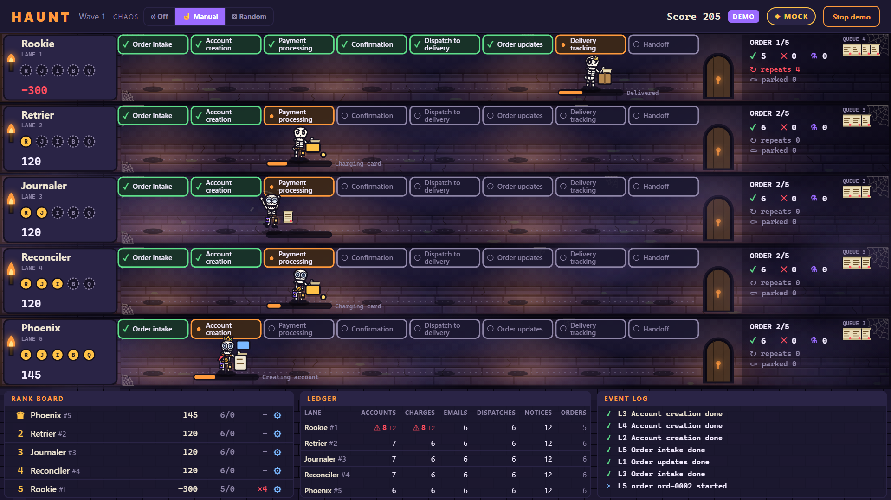
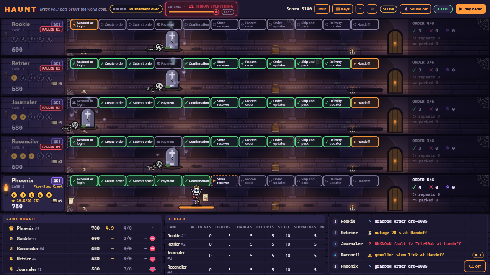
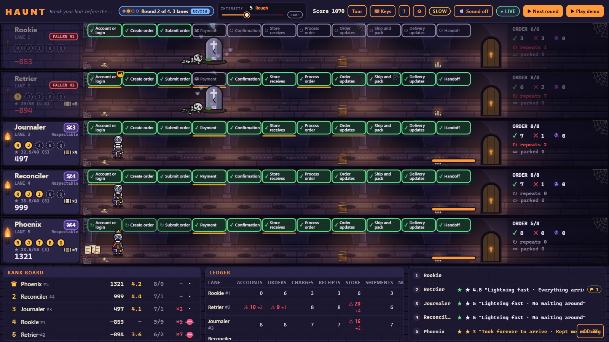
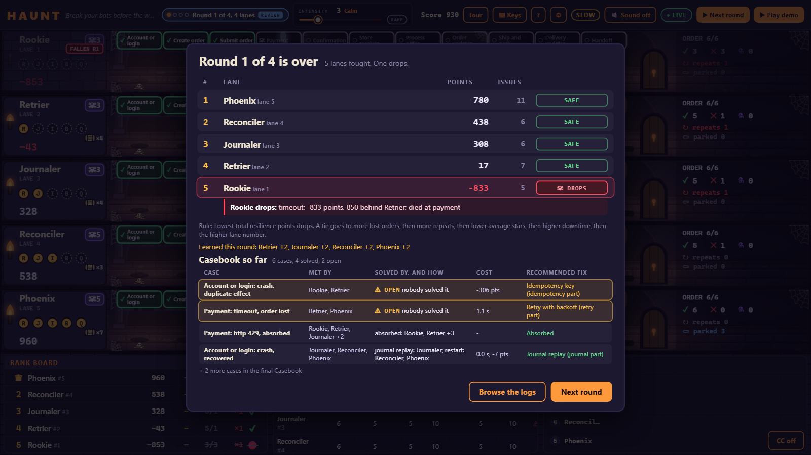
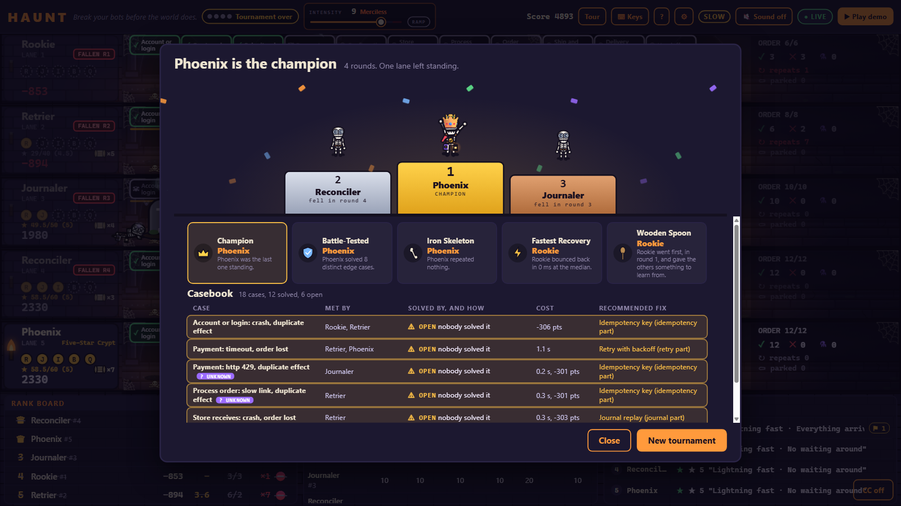
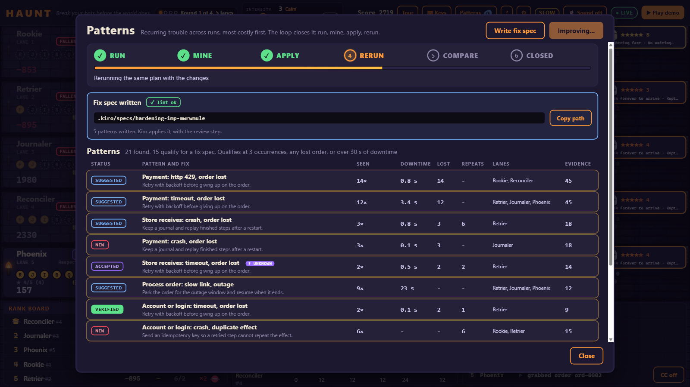
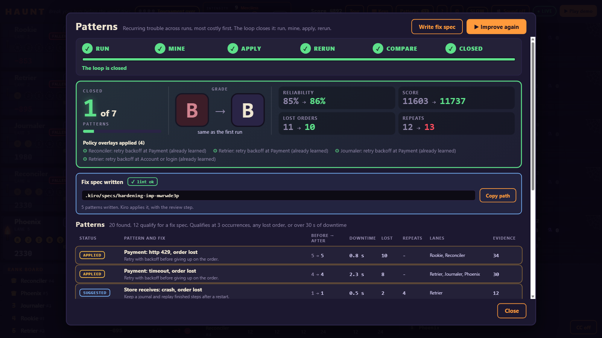
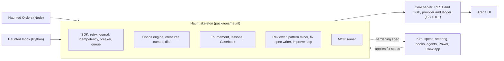

# Haunt

[](LICENSE)
[](#skeleton-crew-fit)



**Break your bots before the world does.** Haunt is chaos engineering played as a tournament: five bots take the same crashes, the worst one dies each round and leaves a corpse, and what is left is a Casebook of every edge case plus a real fix spec that Kiro applies.

## The one story: the same bug in three outfits

A process crashes halfway through, restarts, and does the work again.

| Outfit | What the customer sees | Where it lives in this repo |
|---|---|---|
| Duplicate charge | "Charged. Charged again." | Haunted Orders (Node), running |
| Duplicate ticket | Two tickets and two replies for one email | Haunted Inbox (Python), running. Its ticket step requires an idempotency key |
| Double stream | Two streams for one account | Specified in [`.kiro/specs/packs/spec.md`](.kiro/specs/packs/spec.md), **not built yet** |

The hero number comes from the provider's own ledger, not from the bot: after the same crash right after the charge, **Rookie: 2 charges. Phoenix: 1.** (`packages/haunt/test/hero-crash.test.ts`).

## What it is

- **A skeleton**, the Haunt harness in [`packages/haunt/`](packages/haunt/): the SDK (retry, journal, idempotency keys, circuit breaker, offline queue), the chaos engine and creatures, the ledger and scoring, sweep and ramp runs, the report, the reviewer, the pattern miner and the fix spec writer, and an MCP server.
- **Two real apps** on it, in two folders and two languages:
  - [`apps/haunted-orders/`](apps/haunted-orders/) (Node): an 11-step order pipeline from account to handoff, with five bot tiers from Rookie to Phoenix.
  - [`apps/haunted-inbox/`](apps/haunted-inbox/) (Python 3.12, standard library only): the Ticket Desk inbox bot. It reads mail, classifies it, files a ticket, drafts and sends a reply, and archives. It runs through the same harness with a `haunt.yaml` and no engine changes.
- **A streaming demo** is the planned third outfit. Today the Workflow Lab ships presets for Orders, Inbox, Payments and Report generator, all labelled model-based. There is no streaming preset yet.

## Features

| Feature | What it does | Where |
|---|---|---|
| Tournament | Rounds of 5, 4, 3, 2 lanes on the same seeded storm. The lowest lane is eliminated each round and leaves a corpse on the stage where it died | `packages/haunt/src/tournament`, `packages/arena-ui/src/arena/tournament*.ts` |
| Intensity dial | Live dial from 1 to 10, then **11 THROW EVERYTHING**, with a RAMP toggle | `packages/arena-ui/src/arena/dial.ts` |
| Curses | Persistent per-lane traits (cursed 404, slow endpoint, flaky 500, clock skew, rate limit). The report shows how each lane reacted | `packages/arena-ui/src/arena/curses.ts` |
| Lessons | A lane that overcomes an edge case records the mechanism and applies it in later rounds (a policy overlay, not code) | `packages/haunt/src/tournament` |
| Casebook | Every edge case seen, who solved it, how, and what it cost. Awards: Champion, Battle-Tested, Iron Skeleton, Fastest Recovery, Wooden Spoon | `packages/arena-ui/src/arena/casebook-view.ts` |
| Pattern miner | Clusters recurring problems across runs into `.haunt/patterns.json` | `packages/haunt/src/miner` |
| Fix specs | Writes `.kiro/specs/hardening-<run>/` (requirements with evidence, smallest patch, a test per requirement) and lints it with `haunt spec-lint` | [sample](docs/proof/sample-hardening-spec/index.md) |
| Improve loop | Run, mine, apply cheap fixes as policy, rerun the same plan, compare | [sample report](docs/proof/sample-hardening-spec/improve-report.txt) |
| Report and badge | Graded JSON, Markdown and offline HTML; SVG badge and scorecard | `haunt badge` |
| Workflow Lab | Model your own workflow in the browser and get a graded what-if | `packages/arena-ui/workflow-lab.html` |
| MCP server and Power | `haunt_define`, `haunt_sweep`, `haunt_ramp`, `haunt_report`, `haunt_badge` | `packages/haunt/src/mcp`, [`kiro-power/`](kiro-power/) |

## Screenshots

Captured from the running UI ([`docs/proof/ui-tv3/`](docs/proof/ui-tv3/)).

| | |
|---|---|
|  |  |
| Dial at 11 | Corpses and fallen lanes |
|  |  |
| Round end: standings and Casebook | Final screen: champion, awards, Casebook |
|  |  |
| Patterns and the improve loop running | Compare report |

More: [lessons learned](docs/proof/ui-tv3/lessons-learned.png), [curses board](docs/proof/ui-tv3/curses-board.png).

## Quick start

Needs Node 20 or newer. The inbox app also needs Python 3.12 (standard library only).

```
npm ci
npm run demo
```

`npm run demo` builds the bots (and the arena UI if it is missing), starts the live server on `127.0.0.1:7070` and opens the arena on the 60-second hero demo. Use `npm run demo -- --script=loop` for the fix-and-rerun story. Everything binds to `127.0.0.1`; stop with Ctrl+C.

| Command | Does |
|---|---|
| `npm run haunt -- sweep [--tier T] [--seed N] [--orders N]` | Graded sweep of one bot tier |
| `npm run haunt -- ramp [--tier T]` | Raises load until the bot breaks |
| `npm run haunt -- spec-lint <dir>` | Lints a generated fix spec |
| `npm run live` / `npm run mock` | Live server only / mock server (no engine) |
| `npm run typecheck`, `npm test`, `npm run validate:events` | Local checks |

## Architecture



Static copy: [`docs/img/architecture.svg`](docs/img/architecture.svg). The seam between core and visuals is [`contract/`](contract/).

## Status: what is real, model-based and recorded

| Item | Status |
|---|---|
| Orders app, five tiers, hero crash (2 charges vs 1) | **Real.** Real child processes against a real local provider and ledger |
| Inbox app (Python) through the same harness | **Real.** Spawned through the runner and covered by tests in `apps/haunted-inbox/test` |
| Tournament, dial, curses, lessons, Casebook, miner, fix specs, improve loop | **Real code**, merged in the TV3 PRs. Sample output is in `docs/proof/sample-hardening-spec/` (improve loop on that seeded run: "closed 5 of 9 patterns", grade C to B) |
| F to A loop proof | **Recorded fix.** On the crash-only loop plan wave 1 is F and wave 2 is A, but `rookie.hardened.ts` was written ahead of time, not applied by a live Kiro session ([live-fix.md](docs/proof/live-fix.md)) |
| Kiro applies a generated fix spec live | **Not yet recorded.** Planned for the video |
| Workflow Lab | **Model-based.** Rules over declared protections, not your real code |
| Ticket Desk full 11-stage flow, Jira/Asana/KACE fake adapters | **Specified, not built** (task PK-C3). Today the inbox has 6 stages |
| Streaming pack, production mode (`haunt monkey`) | **Specified, not built** |
| Kiro Power and Crew app | Manifests start the same MCP server (handshake proof in [`docs/proof/installed/`](docs/proof/installed/)). **Not yet installed into a Kiro IDE or Kiro Crew window** |
| Hosted demo URL | **Not published yet** (build exists: `npm run build:hosted`) |
| Tests | 1,434 tests in 157 files, local only. On one run 1,432 passed and 1 failed with a worker timeout under load. CI is manual only (GitHub billing) and never runs tests |

## Skeleton Crew fit

The rule: "Build a skeleton code template lean enough to be clear but flexible enough to support various use cases. Show us its versatility with two distinct applications from your foundation."

The skeleton is the harness. An app is a process definition (`haunt.yaml`: stages, effects, start command, truth endpoint, targets) plus a bot. Orders is Node and moves money and parcels. Inbox is Python and files tickets and sends replies. Neither needed an engine change, and the inbox uses a small Python SDK (`apps/haunted-inbox/bot/haunt_py.py`) with the same journal format. Where we are weaker: the third outfit (streaming) is only designed. The honest fit check is [`docs/FIT-CHECK.md`](docs/FIT-CHECK.md).

## How Kiro built this

| Kiro feature | What it did here | Where |
|---|---|---|
| Specs | 12 spec folders, 30 files, with requirements, design, tasks and acceptance | [`.kiro/specs/`](.kiro/specs/) |
| Steering | Product, tech, contract and art rules | [`.kiro/steering/`](.kiro/steering/) |
| Hooks | Validate fixtures on contract save, property test on SDK save, trace on spec or test save, lint hardening specs, reviewer at wave end | [`.kiro/hooks/`](.kiro/hooks/) |
| Agents | `chaos-director` and `reviewer`, with path-limited write access | [`.kiro/agents/`](.kiro/agents/) |
| MCP | `haunt-mcp` stdio server | `packages/haunt/src/mcp` |
| Power and Crew app | The MCP server packaged twice | [`kiro-power/`](kiro-power/), [`kiro-crew-app/`](kiro-crew-app/) |
| Property tests | fast-check kills the bot at every hook call | `packages/haunt/test/pbt-crash-point.test.ts` |

The candid account, including what Kiro got wrong, is [`docs/KIRO-WRITEUP.md`](docs/KIRO-WRITEUP.md). The log is [`docs/KIRO-LOG.md`](docs/KIRO-LOG.md). The repo has 216 pull requests, one per task.

## Layout

```
packages/haunt/       the skeleton: engine, SDK, CLI, reports, miner, MCP
packages/core/        server, provider, contract implementation
packages/arena-ui/    the arena
apps/haunted-orders/  app 1, Node
apps/haunted-inbox/   app 2, Python
contract/             events schema, fixtures, protocol
kiro-power/           Kiro Power package
kiro-crew-app/        Kiro Crew app package
.kiro/                specs, steering, hooks, agents
```

More docs: [DEV-SETUP](docs/DEV-SETUP.md), [JUDGES](docs/JUDGES.md), [SPEC-MAP](docs/SPEC-MAP.md), [OPEN-ITEMS](docs/OPEN-ITEMS.md), [SUBMISSION-CHECKLIST](docs/SUBMISSION-CHECKLIST.md), [HOW-KIRO-BUILT-THIS](docs/HOW-KIRO-BUILT-THIS.md).

## License

MIT. See [LICENSE](LICENSE).
