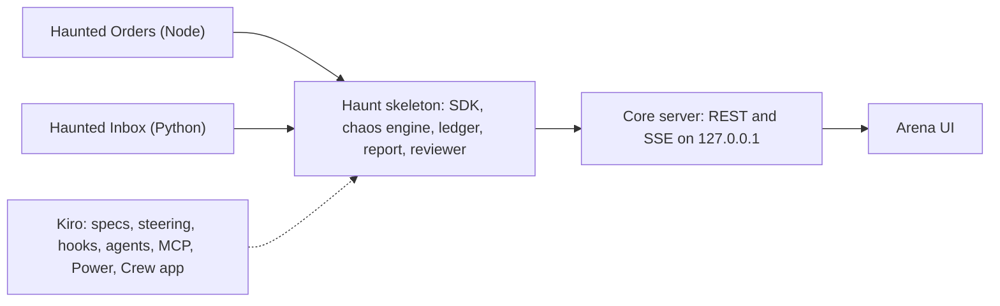

# Haunt

[](https://github.com/kakoritz/Kiroween-Chaos/actions/workflows/ci.yml)
[](LICENSE)
[](docs/proof/loop-proof.md)


**Charged. Charged again.** A bot crashes right after charging a customer, then does the work twice. Haunt is chaos engineering played as a game: five bots take the same crash, the ledger shows who charged once and who charged twice, and you get a graded stress test report for your own workflow.

Rookie: 2 charges. Phoenix: 1. After one Kiro-applied fix the Rookie lane goes from F to A ([loop proof](docs/proof/loop-proof.md)).

Built for Kiroween 2026. Category: **Skeleton Crew** (one lean skeleton, the Haunt harness, and two apps built on it). Also entering Best Kiro Crew App.

## Try it

The hosted demo is a static build of the arena (`npm run build:hosted`, output in `dist/hosted`). It is not published yet, so run it locally with the three commands below.

## 30-second quick start

Requires Node 20 or newer. Python 3.12 (standard library only) is needed for the inbox app.

```
npm install
npm run build:bots
npm run demo
```

`npm run demo` starts the live server on `127.0.0.1:7070` and opens the arena playing the 60-second hero demo. Use `npm run demo -- --script=loop` for the F to A story. Everything binds to `127.0.0.1` only. Stop with Ctrl+C.

More commands:

| Command | Does |
|---|---|
| `npm run haunt -- sweep [--tier T] [--seed N] [--orders N] [--speed N]` | Graded sweep of one bot tier (rookie, retrier, journaler, reconciler, phoenix) |
| `npm run haunt -- ramp [--tier T]` | Raises chaos until the bot breaks |
| `npm run live` | Live server only. Add `-- --loop` to run the hardened Rookie from wave 2 |
| `npm run mock` | Mock server, no engine needed ([details](docs/MOCK-SERVER.md)) |
| `npm run ui:build` | Builds the arena UI |
| `npm run typecheck`, `npm test`, `npm run validate:events` | Local checks. Tests run locally only, never in CI |

## Two apps, one skeleton

| App | Language | What it does |
|---|---|---|
| [Haunted Orders](apps/haunted-orders/) | Node | Order pipeline with a charge step, ships bots from Rookie to Phoenix |
| [Haunted Inbox](apps/haunted-inbox/) | Python | Inbox bot (`haunt.yaml` plus Python bot), run through the same harness |

Both plug into the Haunt skeleton in [packages/haunt/](packages/haunt/): the chaos engine, the SDK, the ledger and the report. Adding a third app means writing an adapter, not a new harness.

## How Kiro built this

Kiro drove the whole build from specs, not chat. Every piece below is a file you can open.

| Kiro feature | What it did here | Where |
|---|---|---|
| Specs | Requirements, design, tasks and an acceptance file per area | [.kiro/specs/](.kiro/specs/) |
| Steering | Keeps every session on the same product rules | [.kiro/steering/product.md](.kiro/steering/product.md) |
| Hooks | Regenerate fixtures on contract save, run property tests on SDK save, run the reviewer at wave end | [.kiro/hooks/](.kiro/hooks/) |
| Agents | A chaos director that picks creatures and a reviewer that writes the fix spec | [.kiro/agents/](.kiro/agents/) |
| MCP | Server with `haunt_define`, `haunt_sweep`, `haunt_ramp`, `haunt_report` | [packages/haunt/src/mcp/](packages/haunt/src/mcp/) |
| Power | The MCP server packaged as a Kiro Power | [kiro-power/](kiro-power/) |
| Crew app | Haunt as a Kiro Crew app with a reviewer agent and a skill | [kiro-crew-app/](kiro-crew-app/) |
| Property tests | fast-check crash-point tests over the SDK | [packages/haunt/](packages/haunt/) |

The build log is [docs/KIRO-LOG.md](docs/KIRO-LOG.md). Two lanes (core and visuals) worked against one contract, [contract/CONTRACT.md](contract/CONTRACT.md), one branch and one pull request per task.

## Architecture



Static copy: [docs/architecture.svg](docs/architecture.svg).

## Layout

```
packages/haunt/          the skeleton: engine, SDK, CLI, reports
packages/core/           server, provider, contract implementation
packages/arena-ui/       the arena
apps/haunted-orders/     app 1, Node
apps/haunted-inbox/      app 2, Python
contract/                events schema, fixtures
kiro-power/              Kiro Power package
kiro-crew-app/           Kiro Crew app package
.kiro/                   specs, steering, hooks, agents
```

## Docs

- [docs/DEV-SETUP.md](docs/DEV-SETUP.md): setup and conventions
- [docs/MOCK-SERVER.md](docs/MOCK-SERVER.md): the mock server
- [docs/SPEC-MAP.md](docs/SPEC-MAP.md): which document wins
- [docs/OPEN-ITEMS.md](docs/OPEN-ITEMS.md): decisions and what needs a human
- [docs/HANDOFF-CORE.md](docs/HANDOFF-CORE.md) and [docs/HANDOFF-VISUALS.md](docs/HANDOFF-VISUALS.md)
- [docs/WINNING.md](docs/WINNING.md), [docs/SWIMLANES.md](docs/SWIMLANES.md), [AGENTS.md](AGENTS.md), [docs/DEMO-SCRIPT.md](docs/DEMO-SCRIPT.md)

## License

MIT
