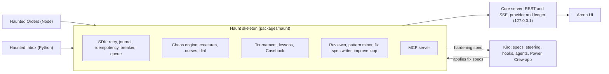

# Kiroween Chaos

[](LICENSE)
[](#skeleton-crew-fit)


Chaos Monkey for AI agents, played as a haunted house. Kiroween Chaos crashes and curses your bots, grades how they survive, and shows the exact fix. One engine, two apps: Node and Python. **Break your bots before the world does.** Five bots take the same crashes in a tournament, the worst one dies each round and leaves a corpse, and what is left is a Casebook of every edge case plus a fix spec that Kiro can apply.

**The hero moment:** a process crashes right after charging a customer, restarts, and charges again. The provider's own ledger decides who is right: **Rookie: 2 charges. Phoenix: 1** ([`hero-crash.test.ts`](packages/haunt/test/hero-crash.test.ts)). The same bug shows up as a duplicate ticket in the second app.

## Try it

**No install (hosted build).** The arena, Workflow Lab and campaign run in your browser. The tournament, Casebook and improve loop replay recorded runs of the real engine, and a banner says so. The public URL is in [`docs/JUDGES.md`](docs/JUDGES.md). To serve the same build yourself: `npm ci && npm run build:hosted && npm run serve:hosted` (http://127.0.0.1:8080/; `npm run serve:hosted -- 18080` picks another port).

**Local, real engine** (Node 20+; Python 3.12 only for the Ticket Desk, standard library only):

```
npm ci
npm run demo
```

`npm run demo` builds the bots and arena if needed, starts the live server on `127.0.0.1:7070` (provider on 7071) and opens the 60-second hero demo. Other ports: `HAUNT_PORT=17070 HAUNT_PROVIDER_PORT=17071 npm run demo`. `-- --script=loop` plays the fix-and-rerun story, `-- --no-open` only prints the URL. Everything binds to `127.0.0.1`. Stop with Ctrl+C.

In the arena: **Start tournament**, press **Next** between rounds, drag **INTENSITY**, open **Patterns**, switch the app to **Haunted Inbox**. Full tour: [`docs/JUDGES.md`](docs/JUDGES.md).

## The two apps

| App | Language | What it does |
|---|---|---|
| [`apps/haunted-orders/`](apps/haunted-orders/) | Node | 11-stage order pipeline (account to handoff), five bot tiers Rookie to Phoenix. Money and parcels |
| [`apps/haunted-inbox/`](apps/haunted-inbox/) | Python 3.12 | Ticket Desk: reads mail, classifies, files a ticket, drafts and sends a reply, archives. Same harness: a `haunt.yaml` and no engine change |

A third outfit (streaming) exists only as a model-based pack in [`packs/`](packs/) and a Workflow Lab preset. It has no runnable app.

## What is in the box

| Feature | What it does |
|---|---|
| Tournament | Rounds of 5, 4, 3, 2 lanes on one seeded storm. The lowest lane falls and leaves a corpse where it died. Lessons carry into later rounds as a policy overlay, not code |
| Campaign | Haunted Nights: seven nights, a gear shop, medals. You choose which protections your crew wears |
| Intensity dial | 1 to 10, then **11 THROW EVERYTHING**, with a RAMP toggle |
| Curses | Per-lane traits: cursed 404, slow endpoint, flaky 500, clock skew, rate limit |
| Casebook | Every edge case, who solved it, how, what it cost. Awards: Champion, Battle-Tested, Iron Skeleton, Fastest Recovery, Wooden Spoon |
| Fix specs | The miner clusters recurring problems into `.haunt/patterns.json` and writes `.kiro/specs/hardening-<run>/` ([sample](docs/proof/sample-hardening-spec/index.md)). Nothing is applied automatically |
| Monkey (guarded) | `haunt monkey` injects faults through a proxy. `observe` injects nothing, `staging` is capped, `prod-guarded` needs a config with a schedule window and an allowlist, `haunt stop` is the kill switch ([`docs/PRODUCTION-MODE.md`](docs/PRODUCTION-MODE.md)) |
| Workflow Lab and packs | Model your own workflow in the browser (`/workflow-lab.html`) and get a graded what-if. Presets: Orders, Inbox, Payments, Report generator, Streaming pack. Always labelled model-based |
| Reports | Graded JSON, Markdown, offline HTML, SVG badge (`haunt badge`) |
| MCP server and Power | `haunt_define`, `haunt_sweep`, `haunt_ramp`, `haunt_report`, `haunt_badge` ([`kiro-power/`](kiro-power/)) |

## Commands

The CLI is `npm run haunt -- <args>`. There is no `haunt` binary on your PATH (`npx haunt` does not work).

| Command | Does |
|---|---|
| `npm run haunt -- ramp --tier phoenix --orders 4 --steps 1,2 --speed 16 --no-gate` | Raises concurrency until the bot breaks. About 12 s as written |
| `npm run haunt -- sweep --tier phoenix --orders 1 --speed 16` | Graded sweep, one fault per stage and creature. **About 5 minutes even with these flags** |
| `npm run haunt -- monkey --mode staging --dry-run` | Prints what the monkey would inject; nothing runs |
| `npm run haunt -- spec-lint <dir>` | Lints a generated fix spec |
| `npm run demo -- --check` | Starts a server on a free port, checks it answers, exits. About 6 s |
| `npm run validate:events` | Fixtures against the event schema and ordering rules |
| `npm run validate:live` | Plays hero, a wave, a campaign night and an inbox wave on a private server and checks every event against the contract rules. About 2.5 minutes. Expect `0 violations` |
| `npm run verify` | typecheck, tests, bots, UI build and demo check in one command. The script is in PR #253; once that merges it works from a clean checkout |

Everything else (`npm run live`, `mock`, `test`, `typecheck`, `e2e`) is in [`docs/DEV-SETUP.md`](docs/DEV-SETUP.md).

## The improve loop, plainly

The loop runs the plan, mines patterns, applies the cheap fixes as policy overlays, reruns the same seed and compares. It never applies code. The deterministic version (an in-process virtual-time engine, so grades reproduce) reaches grade A on seeds 7, 11 and 23 **in the simulator**. That is a projection: parts a lane lacks are simulated in the rerun, so it is not a live rerun of patched code. The code fix itself is applied by Kiro from the generated spec ([`docs/proof/live-fix.md`](docs/proof/live-fix.md) records one). Until the deterministic version merges, `haunt improve` replays in real time and takes more than 8 minutes (measured).

## Architecture



Static copy: [`docs/img/architecture.svg`](docs/img/architecture.svg). The seam between core and visuals is [`contract/`](contract/).

## Layout

```
packages/haunt/       the skeleton: engine, SDK, CLI, reports, miner, monkey, MCP
packages/core/        live server, mock server, provider, campaign data
packages/arena-ui/    the arena, Workflow Lab, hosted build
apps/haunted-orders/  app 1, Node
apps/haunted-inbox/   app 2, Python
packs/                scenario packs (ticketing, streaming), data only
contract/             events schema, fixtures, protocol
tools/                demo, e2e, validate-live, hosted build, trace
kiro-power/, kiro-crew-app/   the MCP server packaged for Kiro
.kiro/                specs, steering, hooks, agents
```

More docs: [DEV-SETUP](docs/DEV-SETUP.md), [JUDGES](docs/JUDGES.md), [SPEC-MAP](docs/SPEC-MAP.md), [HOW-KIRO-BUILT-THIS](docs/HOW-KIRO-BUILT-THIS.md).
## Known limits

- **Sweep is slow.** About 5 minutes with `--orders 1 --speed 16`, longer with defaults. For a quick look use `ramp`, `demo -- --check` or `validate:live`.
- **Sim vs live.** The improve projection, the Workflow Lab, the hosted tournament and the packs are model-based or recorded. Only `npm run demo` runs real child processes against the real provider and ledger.
- **Mobile.** The arena draws a fixed 1280x720 canvas, so a 390x844 phone shows it at about 30%. Use a desktop browser.
- **Ticket Desk.** The inbox app runs 6 stages today. The 11-stage ticketing pack is specified, not a runnable app.
- **Kiro Power and Crew app.** Their manifests start the same MCP server (handshake proof in [`docs/proof/installed/`](docs/proof/installed/)). They are not yet installed into a Kiro window.
- **Tests run locally.** CI does not run them. A worker timeout under load is a known flake: rerun that file alone.

## Skeleton Crew fit

The skeleton is the harness. An app is a process definition (`haunt.yaml`: stages, effects, start command, truth endpoint, targets) plus a bot. Orders is Node, Inbox is Python with a small SDK (`apps/haunted-inbox/bot/haunt_py.py`) writing the same journal format. Neither needed an engine change. Honest check: [`docs/FIT-CHECK.md`](docs/FIT-CHECK.md).

## How Kiro built this

Specs ([`.kiro/specs/`](.kiro/specs/)), steering ([`.kiro/steering/`](.kiro/steering/)), hooks ([`.kiro/hooks/`](.kiro/hooks/)), two path-limited agents ([`.kiro/agents/`](.kiro/agents/)), an MCP server, and fast-check property tests that kill the bot at every hook call. Candid account: [`docs/KIRO-WRITEUP.md`](docs/KIRO-WRITEUP.md).

More docs: [DEV-SETUP](docs/DEV-SETUP.md), [JUDGES](docs/JUDGES.md), [DEMO-SCRIPT](docs/DEMO-SCRIPT.md), [SPEC-MAP](docs/SPEC-MAP.md).

## License

MIT. See [LICENSE](LICENSE).
