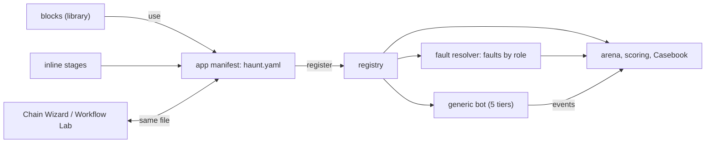

# How the modular engine works

Kiroween Chaos does not know your app. It knows four kinds of step. An app is a list of steps. The harness attacks the steps by kind and counts what really happened in the provider's ledger.

## The idea in one picture

## Parts

| Part | What it is | Where |
|---|---|---|
| Role | One of `input` (reads), `work` (thinks), `effect` (changes the outside world), `poll` (waits), `final` | `packages/haunt/src/config/haunt-config.ts` |
| Block | A reusable step: id, label, role, effects, time. 22 ship | [`BLOCKS.md`](BLOCKS.md), `packages/haunt/src/blocks/library.ts` |
| Manifest | `haunt.yaml`: an ordered list of stages, each a block (`use:`) or written inline | `apps/haunted-playback/haunt.yaml` |
| Registry | The live list of apps: the three built-in ones plus any manifest registered at start | `packages/haunt/src/shared/registry.ts` |
| Fault resolver | Decides which fault can land on which stage, by role | `faultFacesStage` in `packages/haunt/src/chaos/catalog.ts` |
| Generic bot | A real bot for any manifest, at the five tiers, built on the same SDK | `packages/haunt/src/bot/generic.ts`, `apps/generic/` |
| Contract v1.4 | Effect kinds are open: any lowercase name | [`contract/V1_4.md`](../contract/V1_4.md) |
| Contract v1.3 | Stage ids and order prefixes are open; `hello.stages` carries the list | [`contract/V1_3.md`](../contract/V1_3.md) |

## How a fault finds its stage

1. A fault says which roles it can hit. `http_500` hits `effect` and `poll`. `missing_file` hits `input`. `crash` hits all roles.
2. The registry gives every stage its role.
3. `faultFacesStage(fault, stage, app)` is true when the roles match and the stage does not `deny` that fault.
4. The three built-in apps keep their exact old fault lists. A golden test (`packages/haunt/test/golden-apps.test.ts`) fails if any of them changes.
5. A new app gets its faults with no catalog edit. A stage can opt out: `deny: [http_429]`.

World faults (weather, wrong address) and Ticket Desk faults (SLA breach) belong to Orders and the Ticket Desk and do not land on a new app.

## How a run is judged

The provider is a separate fake service. It writes one ledger row per effect call. The score comes from the ledger, not from what the bot says. A Rookie that dies after an effect and starts again writes the row twice. A Reconciler or Phoenix does not, because it sends an idempotency key and journals what it did. This is the same for Orders, the Ticket Desk, Playback, Coffee Shop and your app.

## Test one block, then chain them

- **Alone.** Every block can run as a one-stage app (`blockAsApp`). `runBlock(id, tier)` attacks it with every fault that fits its role and returns a card: attacks tried, survived, repeats, faults it failed.
- **Chained.** The Chain Wizard (`chain.html`) orders blocks, edits the `haunt.yaml` both ways and runs the chain. The report says which block caused which share of the failures.
- **Warnings.** Checks catch weak chains whose blocks passed alone: no input stage, two effects sharing a key, an effect without a required idempotency key, a wait right after an effect, a weak block.
- **Your own block.** An inline stage is a custom block. `npm run block:add -- <haunt.yaml> <stage>` saves it into `blocks/user.yaml`.

The wizard and the Lab are model-based: they apply the same rules to the protections a tier has. They do not run your code. A real run in the arena does.

## What is fixed, on purpose

- The five roles and the five tiers.
- The fake provider's ten known kinds (`account_create`, `order`, `charge`, `email`, `store`, `dispatch`, `notify`, `ticket`, `refund`, `discount`) keep their routes. Any other lowercase kind, such as `sms`, is recorded under its own name through `POST /effects/<kind>` (contract v1.4).
- Order files are `ord-0001.json`. The arena shows your app's own prefix.
- 1 to 24 stages per app.

## Limits

- A pack creature name is display only: the sprite and the rules are the engine's. An app gives names with a `creatures:` list (see [`STREAM.md`](STREAM.md)). An `attacks:` list tunes a fault (count or window) on your stages: see [`INTEGRATE.md`](INTEGRATE.md).
- On the hosted page, Playback and the Coffee Shop run in the browser engine (no real bot processes). Run locally for real bots.
