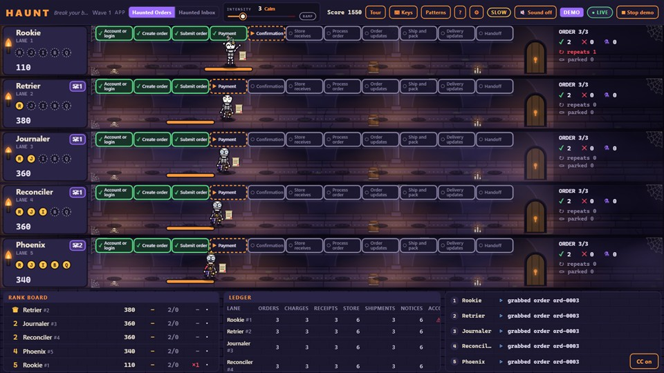
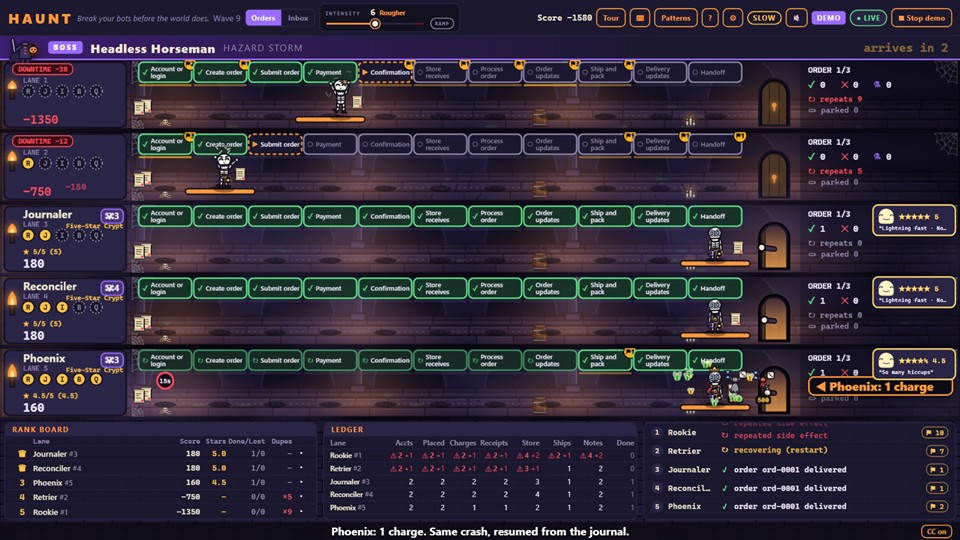
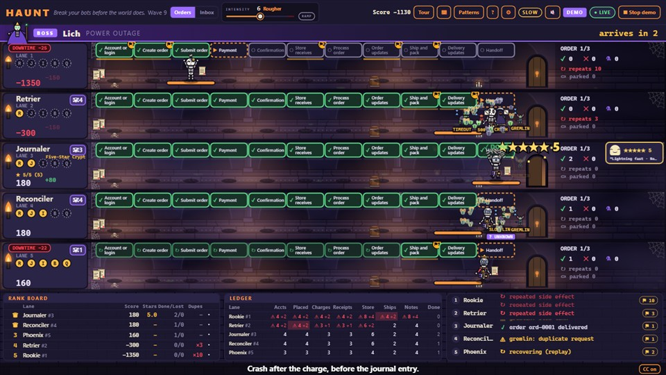

# Arena UI audit against the play-test feedback

Method: `npm run ui:build`, `npm run demo -- --no-open` on private ports, driven in headless Chrome over DevTools at 1280x720, 1600x900 and 1920x1080 (the stage is a fixed 1920x1080 design scaled to fit). Each owner item was looked at in a real screenshot or probed in the DOM, then marked pass or fail. "Before" is `main` at the start of this branch, "after" is this PR.

## Pass / fail table

| # | Owner feedback | Before | After | Notes |
|---|---|---|---|---|
| 1 | Explain R J I B Q (legend, tooltips) | FAIL | PASS | Legend existed but had no tooltips on the lane card. Hover on a badge now shows part, what it does, and whether the tier has it. Legend is tabbed Gear / Chips / Creatures (was one scrolling page cut off at the Chips list). |
| 2 | Skeleton starts at the track start and grabs the order from the START stack | PASS | PASS | Verified at 2 s of the hero demo: stack of scrolls at the left end, skeleton at the first station. |
| 3 | Handoff door ceremony (door opens, stars float, door closes, runs back) | PASS | PASS | Door ajar with hand and scroll seen in captures. |
| 4 | Slower pace | PASS | PASS | SLOW tag in the header, default Slow. |
| 5 | One row per lane ticker, clickable live lane popup | PARTIAL | PASS | One row per lane was already built. Clicking a row opened the popup focused on one stage and showed an empty log; it now opens the whole lane log. Empty rows now read "waiting for the next order". Review lines no longer show two stars. |
| 6 | Chips green / red / yellow, issue flags, heat strip | PASS | PASS | Green passed, amber flag on healed chips, heat strip under the chips. |
| 7 | Lap stats (best / slowest / avg, retries, delays) | PASS | PASS | In the popup and in the wave end card. |
| 8 | Downtime as negative score | PASS | PASS | `DOWNTIME -87` chip on the lane card and negative scores. |
| 9 | Mini-boss recovery bonus | PARTIAL | PASS | `RECOVERED +150` worked but was a 770 px slab over the chips and track of three lanes. Now a 420 px banner in the lower half of the lane. |
| 10 | Cancelled order big loss visual | PASS | PASS | Slam text, now smaller (56 px) and aligned to the lane. |
| 11 | World event visuals | PASS | PASS | Outage ring, boss banner, curses. |
| 12 | Yelp style reviews with cumulative tracker (5/5, 6/10, 8/15) | PASS | PASS | Label card shows `5/5`, `9.5/10`, `13.5/15`. |
| 13 | Header gear menu for chaos, closes after Random | PASS | PASS | Probed: after clicking Random the popover is hidden and the server mode is `random`. |
| 14 | Clearer demo buttons | PASS | PASS | `Play demo` / `Stop demo`. |
| 15 | Wave end waits for Next, logs browsable | PASS | PASS | Wave card has Next wave, Close and View report; the header Next button stays. |
| 16 | Popup log frozen when another order is picked | PASS | PASS | Pinned view only follows its own order (code path `pinned`). |
| 17 | Half-size review card over the ORDER card, door visible | PARTIAL | PASS | The card (236 px) hid the order counter and the failed tally. Now 168 px, counter and checks stay visible. |
| 18 | 11-stage board readable at 1280, 1600, 1920 | PARTIAL | PASS | Header overflowed 1920 by 12 px (Next wave clipped at 1600). Panels now fit and no clipping at all three sizes. |
| 19 | Swarms that shoo and dissipate | PASS | PASS | Seen dissipating (gremlin trail). |
| 20 | Corpses persist | PASS | PASS | Covered by existing tests; fallen lanes stay greyed. |
| 21 | Dial 1..11 | PASS | PASS | Dial 11 shows `THROW EVERYTHING` and the lanes keep up. |
| K1 | Ledger columns clip off to the right, ACCOUNT/ORDERS headers jumbled | FAIL | PASS | Two columns were both called Orders, and the provider kind `account` created a second Accounts column. Now fixed-width table, short headers (Accts, Placed, Ships, Notes, Done) with full names in tooltips, kinds folded. |
| K2 | Rank board and log cut off at 900 px | FAIL | PASS | Panels were 232 px tall in the last 236 px and the caption strip covered them. Panels are 196 px, the caption strip has its own 36 px, rank board has a column header row. |
| K3 | Star line overlaps R J I B Q and title text | FAIL | PASS | Label card re-laid out: name, lane, gear badges, stars, score on separate rows. |
| K4 | Order counter hidden behind the SAME CRASH banner | FAIL | PASS | Callout is now 290 px wide under the counter, not centred over it. |
| K5 | Log panel mixed rows rather than one row per lane | PASS | PASS | Already one row per lane; verified. |
| K6 | Header crowded after the dial | FAIL | PASS | Sound and Keys are icon only, "App" label is screen-reader only, app names lose the "Haunted" prefix, duplicate `#chaos-mode` element removed. Everything fits at 1920 with the tagline visible. |
| N1 | Wave end card shown for an empty wave, with "Cursed" for lanes without reviews | FAIL | PASS | No card when no lane finished an order; no rating title without reviews. Card enlarged (1440x880) with 14 px text so it reads at 1280. |
| N2 | Wave end card heat row cut stage names ("Order upda 0") | FAIL | PASS | Full names in two columns. |
| N3 | Captions covered the bottom panels; CC button covered the ticker | FAIL | PASS | Caption strip is its own 36 px row. |
| N4 | First 10 seconds of the demo | PASS | PASS | Story starts at once: stack, grab, caption "Five lanes. Five orders. One kitchen." No dead time. |

## Screenshots

Before, 1600x900 (ledger clipped, rank board cut, order counter hidden):

After, 1600x900 (busy state, boss banner, downtime chips, callout under the counter):

After, 1280x720:

## Engine-side gaps (not fixed here, UI is hardened against them)

1. The provider ledger reports kind `account` in some paths and `account_create` in others (`packages/core/src/live/runtime.ts` maps one of them). The UI now folds both into the Accounts column.
2. The wave summary hands out the rating `Cursed` for a lane with zero reviews. The UI hides it; the server should send no rating.
3. Reproduced once: `POST /api/wave/stop`, `POST /api/chaos/mode {random}`, then `POST /api/wave/start {orders:3}` returned `{wave:N}` but `state.wave.running` was false at once and a `wave_end` with an empty summary followed. The UI now ignores an end card with no orders. Worth a look in the live server.
4. `?demo=<script>` starts a new wave on every page load, so the wave number climbs with each reload.

## Tests

New pure-function tests in `packages/arena-ui/test/audit.test.ts` (ledger kind folding and headers, rank board row budget, empty wave summary, rating without reviews, legend tabs, creature list, gear tips, ticker review icon). `npx tsc --noEmit -p packages/arena-ui`, `npx vitest run packages/arena-ui` and `npm run ui:build` pass.
